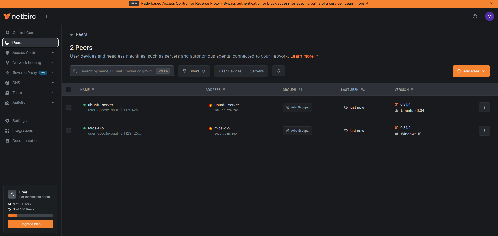
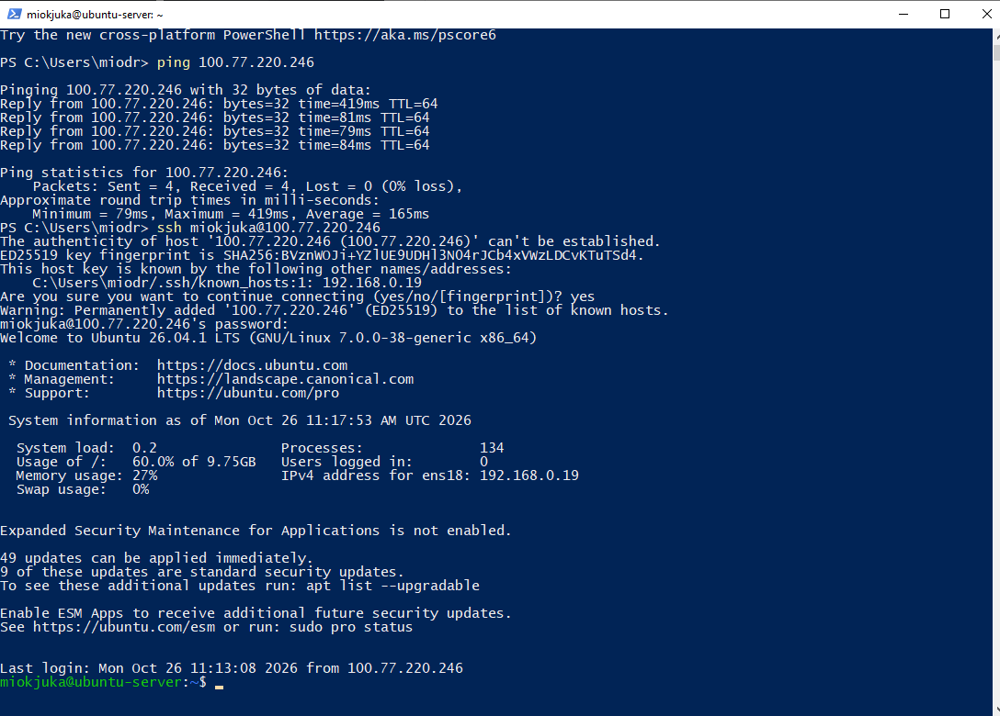
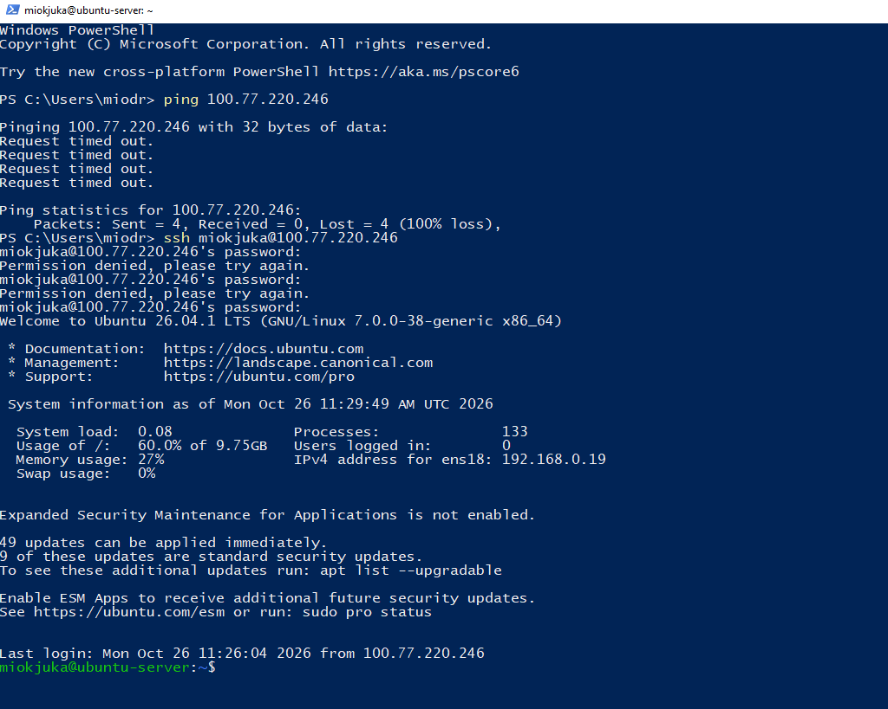

# NetBird VPN Homelab

A private mesh VPN that connects my Windows PC to the Ubuntu Server VM in my [Proxmox homelab](https://github.com/miodragkjuka/proxmox-homelab), with an access policy that only allows SSH.

## What I built

```
Windows PC (mios-dio, 100.77.65.169) ── NetBird mesh ── ubuntu-server VM (100.77.220.246)
                                  policy: my-devices → servers, TCP port 22 only
```

- Installed the NetBird client on a Windows PC and on the Ubuntu Server VM
- Connected both to one NetBird network (free plan)
- Replaced the home-network IP (`192.168.0.x`, which kept changing) with a stable private NetBird IP
- Wrote an access policy so only my PC can reach the VM, and only over SSH (TCP port 22)

## Setup

1. Created a NetBird account and installed the client on the VM:
   ```bash
   curl -fsSL https://pkgs.netbird.io/install.sh | sh
   sudo netbird up
   ```
   The `netbird up` command prints a login link to approve the device.
2. Installed the NetBird client on Windows and signed in with the same account.
3. Checked both devices in the NetBird dashboard.



## Connection test

From Windows, before the policy, `ping` and `ssh` to the VM's NetBird IP both worked.



## Access policy

I put the VM in a group called `servers` and my PC in `my-devices`, turned off the default allow-all policy, and created `ssh-from-my-devices`: source `my-devices`, destination `servers`, TCP port 22, one direction only.


### Result

`ping` now fails with 100% loss, because only TCP port 22 is allowed, while `ssh` still works.



## What went wrong and how I fixed it

- **I tested from the wrong machine.** I ran `ping` while I was still logged in to the VM, so it pinged itself (0.04 ms). I only got a real test after using `exit` to get back to the Windows prompt (`PS C:\...`).
- **Nested SSH sessions.** I had connected to the VM from inside the VM, so one `exit` was not enough to get back to Windows.
- **First policy was too broad.** It showed `TCP` with `ALL` ports and arrows both ways. I limited it to port 22 and one direction.
- **Empty group.** My first policy used a group with no devices in it, which does nothing. I assigned the devices to groups first.
- **Login expiry.** NetBird logs a device out after 24 hours by default, so I turned off login expiration for the VM.

## What I learned

- How a mesh VPN connects devices without opening ports on my router
- Why a stable private IP is better than a changing home-network IP
- Writing least-privilege access rules (groups, protocol, port, direction)
- Testing a firewall rule: one thing must be blocked and one thing must still work

## Next steps

- Put the Dockerized web app behind NetBird
- Add more devices (phone, laptop) to the network
